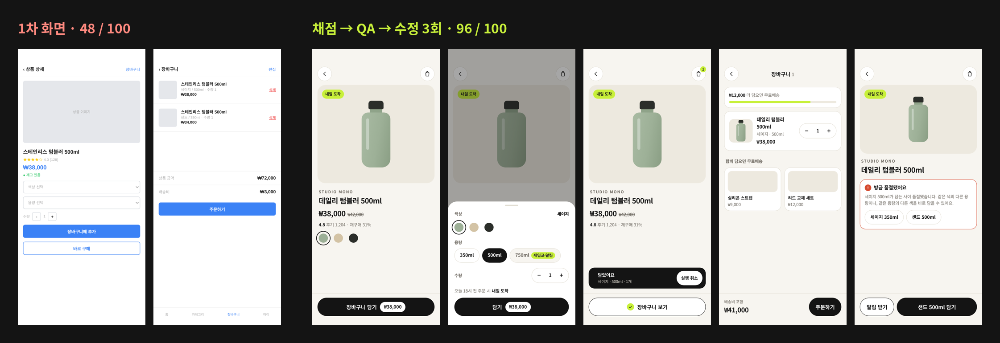

# 디자인 하네스 스타터 키트

**AI가 만든 UX·UI 시안, 실무에 바로 쓰는 법** 워크숍 실습 자료입니다.
AI가 만든 화면을 디자이너의 기준으로 채점하고, 빠진 화면을 찾고, 통과할 때까지 고치게 하는 체계(하네스)를 하루 동안 직접 만들어 봅니다.



같은 기획서, 같은 AI입니다. 왼쪽은 한 번 시켜서 나온 화면(48점), 오른쪽은 채점과 QA를 세 번 돌린 화면(96점)입니다.

## 처음이라면

1. [SETUP.md](SETUP.md) 를 따라 설치합니다. (15분 안팎)
2. 터미널에서 이 폴더로 들어와 `claude` 를 실행합니다.
3. 아래 한 줄을 붙여 넣습니다.

```
이 폴더가 어떤 키트인지 세 줄로 설명하고, node scripts/doctor.mjs 를 실행해서 준비가 됐는지 확인해줘.
```

"준비 완료입니다"가 보이면 끝입니다.

## 하루의 흐름

여섯 교시로 진행합니다. 익숙한 더블 다이아몬드 네 단계에 AI 담당자와 통과 기준을 하나씩 붙입니다.

| 교시 | 하는 일 | 치는 것 | 남는 파일 |
|---|---|---|---|
| 1 | 환경 점검과 강의: 에이전트 이해, 내 눈과 기계 비교 | `/measure examples/before` | 메모 세 줄 |
| 2 | Discover: 인사이트, 내 판단 기준, 추가 질문 | `/insights` `/interview-me` | `01_discover/` |
| 3 | Define: 브리프와 검증할 가설 | `/brief` | `02_define/brief.md` |
| 4 | Develop: AI가 읽는 디자인 규칙, 담당자, 1차 화면 | `/design-check` `designer 에이전트로 ...` `/shot` | `DESIGN.md` `03_develop/screens/` |
| 5 | Deliver: 채점표, 채점, QA, 통과할 때까지 반복 | `/rubric` `claude --agent director` | `04_deliver/` |
| 6 | 정리: 1차와 최종 비교, 내 업무로 옮기기 | `/harness-card` | `04_deliver/my-harness-card.md` |

모든 문장은 [PROMPTS.md](PROMPTS.md) 에 교시 순서대로 있습니다.

## 들어 있는 것

```
.claude/agents/      AI 담당자 4명: designer, reviewer, qa, director
.claude/skills/      슬래시로 부르는 절차 10개
DESIGN.md            AI가 읽는 디자인 규칙 (샘플: Studio Mono)
00_inputs/           실습 재료: 기획서, 인터뷰 기록 3건
01_discover/ ~ 04_deliver/   단계별 작업 폴더
04_deliver/rubric.md         반쯤 채워진 채점표
04_deliver/qa-checklist.md   빠지기 쉬운 화면 체크리스트
scripts/             스크린샷, 기계 측정, DESIGN.md 진단, 점검 도구
examples/            1차 화면, 최종 화면, 따라잡기 파일, 리포트 예시, 레퍼런스 DESIGN.md
templates/           내 업무 하네스 카드, 새 담당자 틀
docs/                가이드 문서, 공개 DESIGN.md 84개 진단 결과
PROMPTS.md           교시별 프롬프트 모음
REFERENCES.md        더 볼 자료
```

가이드 문서:

- [docs/folder-guide.md](docs/folder-guide.md) · 폴더가 이렇게 생긴 이유, 스킬 만드는 법, 내 자료 넣는 곳
- [docs/design-md-guide.md](docs/design-md-guide.md) · DESIGN.md 작성법, 무료와 유료 레퍼런스 파일 분석
- [docs/agent-structures.md](docs/agent-structures.md) · 에이전트란 무엇이고 어떤 구조로 짤까
- [docs/figma-track.md](docs/figma-track.md) · 피그마를 연결할 때와 연결하지 않을 때
- [docs/hook.md](docs/hook.md) · 저장할 때마다 자동으로 검사하기
- [docs/reference-84-result.csv](docs/reference-84-result.csv) · 공개 DESIGN.md 84개를 진단한 결과

## 네 명의 담당자

| 담당자 | 하는 일 | 하지 않는 일 |
|---|---|---|
| designer | DESIGN.md 와 브리프를 읽고 화면을 만들고 고친다 | 채점 |
| reviewer | 채점표로 점수를 매기고 근거와 수정 지시를 남긴다 | 화면 수정 |
| qa | 빈 상태, 오류, 품절처럼 **없는 화면**을 찾는다 | 화면 수정 |
| director | 셋을 순서대로 움직이고, 기록하고, 사람이 판단할 지점에서 멈춘다 | 직접 만들기, 직접 채점 |

핵심은 **만든 담당자가 채점하지 않는다**는 것입니다.

## 누가 무엇을 확인하나

| 확인하는 주체 | 보는 것 | 도구 |
|---|---|---|
| 기계 | 토큰 밖 컬러, 명도 대비, 터치 영역, 글자 크기 | `/measure` |
| AI 리뷰어 | 위계, 컴포넌트 규격, 피드백, 흐름 | reviewer 에이전트 + 채점표 |
| AI QA | 빠진 화면과 예외 상태, 막다른 길 | qa 에이전트 + 체크리스트 |
| 사람 | 내 판단 기준, 최종 승인, 기준 자체를 고칠지 | 갤러리(`03_develop/shots/gallery.html`) |

## 막혔을 때

- 한 단계가 안 풀리면 [examples/checkpoints](examples/checkpoints/README.md) 의 따라잡기 파일을 복사해 다음 단계부터 이어 갑니다.
- 스크린샷이나 측정이 실행되지 않아도 실습은 됩니다. HTML 파일을 브라우저로 직접 열어 보고, 리뷰어는 코드를 읽어 채점합니다.
- `node scripts/doctor.mjs` 가 무엇이 빠졌는지 알려 줍니다.

## 워크숍이 끝난 뒤

회사에서 그대로 쓰려면 세 가지만 바꾸면 됩니다.

1. `DESIGN.md` 를 우리 디자인 시스템으로 (`/design-md`)
2. `04_deliver/rubric.md` 6~10번을 우리 팀 기준으로 (`/rubric`)
3. `04_deliver/qa-checklist.md` 5번에 우리 서비스만의 예외 추가

저장할 때마다 자동으로 검사를 거는 방법은 [docs/hook.md](docs/hook.md) 에 있습니다.

## 만든 사람

이해든 · AX is 대표, 숭실대학교 겸임교수
실습용 서비스 Studio Mono 는 가상의 브랜드입니다.
